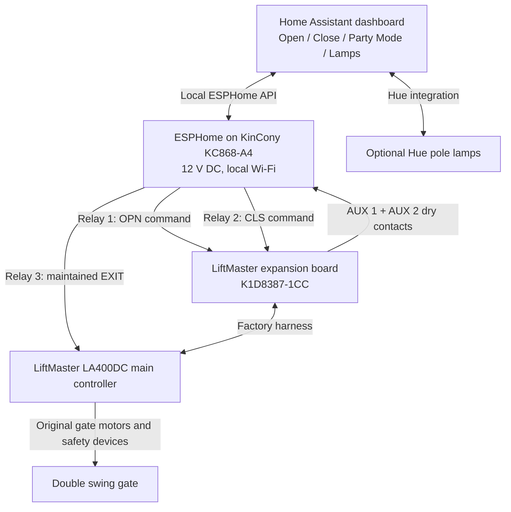

# LiftMaster LA400DC → Local Home Assistant (ESPHome + KinCony)

**An open, community-oriented, step-by-step reference for integrating a LiftMaster LA400DC swing gate operator with Home Assistant without depending on MyQ.**

The implementation documented here uses a LiftMaster expansion board, a KinCony KC868-A4 ESP32 relay controller, ESPHome, and Home Assistant. It adds:

- **Open** and **Close** requests via isolated, momentary relay contacts.
- **Party Mode**: a maintained EXIT request that holds the gate open at its open limit and pauses the normal timer-to-close.
- Two **AUX relay limit indications** for fully open, not-closed, and between-limits status.
- A Lovelace dashboard with an illustrated **double-swing gate**, confirmation dialogs, state-dependent controls, and **two optional Hue post lamps**.

> [!CAUTION]
> **Motorized gates can seriously injure people. This is an educational community project, not a certified gate-control product or an installation approval.** The LiftMaster documentation requires installation/service by a trained gate-system technician. Have all wiring and modifications professionally performed or verified, preserve monitored entrapment protection, and test safety systems to the manufacturer's instructions. The software cannot replace physical safeguards, stop controls, or line-of-sight requirements. Do not enable unattended closing until your installation's applicable safety requirements are satisfied.

## What this is — and is not

- The **gate operator** continues handling motor drive, limits, its timer, and safety devices. Home Assistant sends commands and reads auxiliary status.
- The **two AUX signals do not provide absolute angle or direction**. `Between Limits` can mean opening, closing, or stopped. If the LiftMaster loses power, both auxiliary contacts may drop out and **falsely resemble Closed**; do not use these signals alone for a security assertion or automatic action requiring verified closure.
- The example dashboard's disabled buttons are user-interface aids. The bundled **ESPHome reference** also checks reported position before initiating commands, but no ESPHome code is safety-rated and any other gate control remains possible.
- ESPHome/controller power loss releases Party Mode, potentially allowing timer-to-close to resume. Plan accordingly; **Party Mode is not a life-safety hold-open**.
- Different LiftMaster models, firmware, controller revisions, and legal jurisdictions may require a different design.

## Architecture



## Hardware

| Part | Purpose |
|---|---|
| LiftMaster LA400DC (compatible existing installation) | Main gate operator and original safety controls |
| LiftMaster expansion board **K1D8387-1CC**, matching harness, mounting hardware | Additional command terminals and two programmable AUX status relays |
| KinCony **KC868-A4** ESP32 board (four relays, four digital inputs) | Local dry-contact commands and feedback inputs |
| Regulated **12 V DC** power supply appropriate for the KC868-A4 | Separate controller power — **not** directly from the LiftMaster 24 V accessory output |
| Appropriately rated stranded multi-conductor low-voltage wiring and proper terminal distribution/strain relief | Command and status interconnects |
| Enclosure/mounting hardware suitable for the environment | Physical protection; avoid relying on adhesive alone |
| Optional: two Home Assistant-accessible Hue post lights | Individual lamp controls and status in the gate visualization |

Our example used **10 signal conductors**: 2 each for Open, Close, EXIT hold, AUX1 feedback, and AUX2 feedback. A 12-core cable leaves two spares. Check actual cable listing, temperature rating, terminal fit, and permitted installation method locally; **a UL2464 marking alone doesn't establish suitability for all field wiring**. The project used 20 AWG stranded wire for short runs, but do not assume that is approved for every installation.

## Quick start

1. **Read [Safety & limitations](docs/07-safety-and-privacy.md) first.**
2. Check your operator model, expansion board compatibility, harness, and mounting arrangements using the [LiftMaster guide](docs/01-hardware-and-mounting.md).
3. Bench-power the KinCony and flash ESPHome; verify all relays and digital inputs **before connecting it to the gate**: [ESPHome setup](docs/03-esphome-setup.md).
4. Have a qualified installer install/verify the board and field wiring: [Wiring guide](docs/02-wiring-and-aux-relays.md).
5. Commission feedback, then controls, then Party Mode with the safety checks in [Testing](docs/05-testing-and-commissioning.md).
6. Add [Home Assistant controls](docs/04-home-assistant-dashboard.md) and paste `home-assistant/driveway-gate-card.yaml` into a Manual dashboard card. Install [button-card](https://github.com/custom-cards/button-card) using HACS.
7. Review [Troubleshooting](docs/06-troubleshooting.md).
8. [Publish the repository](docs/08-publishing-to-github.md) once you have checked it for private data.

## Repo contents

```text
.
├── README.md
├── LICENSE
├── CONTRIBUTING.md
├── .gitignore
├── docs/
│   ├── 01-hardware-and-mounting.md
│   ├── 02-wiring-and-aux-relays.md
│   ├── 03-esphome-setup.md
│   ├── 04-home-assistant-dashboard.md
│   ├── 05-testing-and-commissioning.md
│   ├── 06-troubleshooting.md
│   ├── 07-safety-and-privacy.md
│   ├── 08-publishing-to-github.md
│   └── references.md
├── esphome/
│   ├── gate-controller.example.yaml
│   └── secrets.example.yaml
└── home-assistant/
    └── driveway-gate-card.yaml
```

## Examples and validation status

The design and terminal functions were checked against the documentation linked in [References](docs/references.md). In the originating installation, Open, Close, Party Mode, AUX limit feedback, and Home Assistant communication were each observed working. **The generic files in this repository are a reusable reference and have not been independently tested on every hardware revision or installation.** Verify ESPHome/YAML with your own current toolchain and bench-test all behavior before connecting the gate.

## Security and privacy

**Never commit** Home Assistant API encryption keys, Wi-Fi credentials, addresses, identifiable photos of your property, remote access URLs, serial numbers, or the ESPHome `secrets.yaml`. Use the provided `.gitignore` and secret template. Prefer Home Assistant's authenticated local network/VPN access; do not expose ESPHome's API or unauthenticated control endpoints directly to the Internet.

## Contributing

Improvements and tested reports from other operators are welcome. See [CONTRIBUTING.md](CONTRIBUTING.md). In particular, contributions documenting safe fail-state detection and operator-specific differences would be valuable.

## Legal

This is an independent community reference, not affiliated with or endorsed by LiftMaster/Chamberlain, KinCony, Espressif, Nabu Casa, or Signify/Hue. Company and product names belong to their respective owners. Original documentation and example code in this repository are provided under the [MIT License](LICENSE). Manufacturer manuals and third-party software are **linked, not redistributed**.
